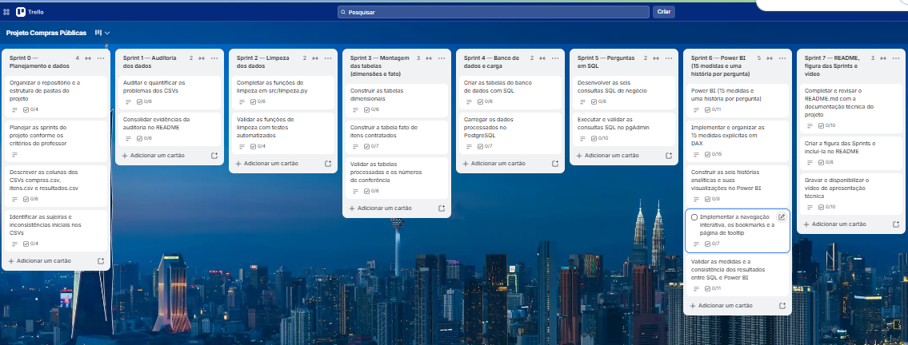

# Projeto Compras Públicas

> Projeto avaliativo de Análise de Dados com Python e PostgreSQL — Módulo 2  
> **Autora:** Caroline de Souza Cunha Lopes

## 1. Visão geral

O **Projeto Compras Públicas** transforma dados de contratações públicas em informações analíticas para apoiar fiscalização, transparência e tomada de decisão. A solução utiliza arquivos do Portal Nacional de Contratações Públicas (PNCP), aplica auditoria e tratamento com Python/pandas, organiza os dados em um modelo dimensional no PostgreSQL e apresenta os indicadores em um dashboard no Power BI.

O projeto responde às seis perguntas de negócio da Controladoria: economia global, concentração de fornecedores, eficácia por modalidade, duração do ciclo de compras, distribuição regional e perfil dos gastos. As conclusões devem ser interpretadas junto às regras de comparabilidade, qualidade dos dados e consultas SQL que produzem os indicadores.

**Repositório:** [projeto-compras-publicas](https://github.com/carolinecunha-coder/projeto-compras-publicas)

## 2. Problema de negócio

A Controladoria precisa identificar padrões que mereçam investigação, entre eles:

- diferenças entre valores estimados e homologados;
- concentração do volume financeiro em fornecedores;
- modalidades que apresentam maior economia ou concentram maior volume;
- demora entre publicação do edital e homologação;
- diferenças de despesas e descontos entre estados e regiões;
- distribuição de recursos entre bens, serviços e obras/engenharia.

Os arquivos de origem podem conter identificadores inconsistentes, valores em texto, datas ausentes ou inválidas, itens sem resultado homologado e registros que não permitem comparar valor estimado e homologado. Por isso, a análise depende de regras de tratamento documentadas, rastreabilidade e validação das métricas.

## 3. Fonte, período e granularidade

- **Fonte:** Portal Nacional de Contratações Públicas (PNCP) / Dados Abertos do Governo Federal.
- **Período:** recorte de 2025 disponibilizado para o projeto.
- **Arquivos brutos:** `compras.csv`, `itens.csv` e `resultados.csv`, previstos em `data/raw/`.
- **Granularidade da fato:** uma linha por item contratado/homologado, com valores, datas, comparabilidade e chaves dimensionais.

As contagens de linhas dos arquivos de origem, itens processados, itens rejeitados e registros da tabela fato são etapas diferentes do pipeline. Não devem ser comparadas como se representassem o mesmo universo. Os totais definitivos devem ser conferidos com o Anexo 8 do enunciado e com a execução dos scripts/consultas do repositório.

## 4. Arquitetura da solução

```text
PNCP / arquivos públicos
        |
        v
data/raw/ (compras.csv, itens.csv, resultados.csv)
        |
        v
Python + pandas
Auditoria • sanitização • padronização • regras de qualidade
        |
        v
PostgreSQL
Modelo dimensional (Star Schema) • chaves • integridade referencial
        |
        v
SQL
Consultas das seis perguntas de negócio • validação dos indicadores
        |
        v
Power BI
Dashboard • filtros • medidas DAX • visualizações
```

## 5. Tecnologias

| Tecnologia | Utilização |
|---|---|
| Python | Orquestração e transformação dos arquivos |
| pandas | Leitura, auditoria, limpeza e preparação dos dados |
| PostgreSQL | Persistência, modelagem dimensional e integridade referencial |
| SQL / pgAdmin | Consultas analíticas e validação das perguntas |
| Power BI | Dashboard, medidas DAX, filtros e apresentação |
| Git / GitHub | Versionamento e histórico das entregas |
| Trello | Planejamento e acompanhamento das Sprints |

## 6. Pipeline de dados

### 6.1 Ingestão e auditoria

Os arquivos brutos devem ser preservados em `data/raw/`. Antes da transformação, a auditoria considera:

- quantidade de linhas e colunas;
- tipos e formatos dos campos;
- campos nulos ou vazios;
- duplicidades;
- consistência dos identificadores;
- relação entre contratação, item e resultado;
- presença de resultado homologado.

### 6.2 Tratamento com Python

Os módulos de `src/` aplicam as regras de tratamento antes da carga no banco.

| Inconsistência | Tratamento / decisão |
|---|---|
| Documento de fornecedor com pontuação, espaços ou formato irregular | Sanitizar e padronizar o identificador; não inventar documento ausente |
| Valor monetário em texto ou separadores inconsistentes | Normalizar e converter para número; não transformar valor inválido em zero silenciosamente |
| Datas em formatos distintos | Padronizar; registrar datas inválidas ou cronologicamente incoerentes |
| Quantidade ou valor incompatível com regra de validação | Rejeitar ou sinalizar conforme regra implementada e registrar motivo |
| Item sem resultado homologado | Não tratar como compra homologada nem atribuir valor homologado artificial |
| Item não comparável | Preservar para análises de volume quando aplicável; excluir da economia comparável |
| UF sem região na fonte | Aplicar mapeamento documentado UF → região |
| Modalidade identificada por código | Mapear `modalidade_id` para nome legível com tabela de referência |
| Duplicidade em arquivos relacionados | Investigar chave de negócio e evitar multiplicação de valores em joins |

**Rastreabilidade:** rejeitar um registro não significa apagá-lo sem explicação. A regra, a quantidade afetada e o motivo precisam ser verificáveis nos scripts ou relatórios de execução.

As decisões específicas de sanitização, escolha do resultado homologado, cancelamentos, desempate e tratamento de datas devem ser descritas conforme o código efetivamente implementado em `src/limpeza.py`, `src/montar_tabelas.py` e `src/carregar.py`. Não se deve declarar uma regra como implementada sem conferência do código e demonstração.

### 6.3 Modelagem dimensional no PostgreSQL

A camada analítica utiliza **Star Schema**, com a tabela fato no centro e dimensões conectadas por chaves substitutas.


**Tabela fato**

- `public.fato_item_contratado`: grão de item contratado/homologado; contém valores estimados e homologados, comparabilidade, economia, datas/ciclo e chaves dimensionais.

**Dimensões**

- `public.dim_fornecedor`: identificação e nome do fornecedor;
- `public.dim_orgao`: órgão/unidade responsável pela contratação;
- `public.dim_modalidade`: modalidade do procedimento;
- `public.dim_localidade`: UF e região;
- dimensão de contratação/tempo, conforme o esquema implementado, para atributos do certame e datas.

Os nomes físicos devem ser confirmados nos scripts de criação e carga. O README não substitui o diagrama nem os scripts SQL.

## 7. Regras para interpretar os indicadores

### 7.1 Comparabilidade e economia

A economia é calculada **somente para itens comparáveis** (`comparavel = 1`):

- **Economia nominal:** soma dos valores estimados comparáveis − soma dos valores homologados comparáveis.
- **Economia percentual:** economia nominal ÷ soma dos valores estimados comparáveis × 100.

O percentual deve ser calculado por **soma ÷ soma**, nunca pela média simples de percentuais individuais. Quando o denominador for zero, a consulta deve tratar o caso com `NULLIF` ou regra equivalente.

Itens não comparáveis não devem ser apresentados como economia positiva ou negativa. O volume homologado total pode ser apresentado separadamente, deixando claro que representa o conjunto total, e não apenas os itens comparáveis.

### 7.2 Ciclo de compra

A duração do ciclo corresponde à diferença em dias entre a publicação do edital e a homologação final. O cálculo considera datas válidas e sequência temporal coerente. Na pergunta por órgão, os registros são agrupados pelo **nome padronizado do órgão** e a consulta aplica o critério mínimo de **cinco itens com ciclo calculado** (`HAVING COUNT(dias_ciclo) >= 5`). O gráfico pode exibir dez órgãos destacados; o número dez corresponde ao recorte visual/ranking, enquanto cinco é o mínimo de registros válidos por órgão. Não são medidas DAX novas.

## 8. Perguntas de negócio da Controladoria

As seis perguntas são respondidas pelas consultas em `sql/02_perguntas.sql` e pelas medidas/visuais do Power BI. Os números abaixo são resultados registrados nas análises do dashboard e devem permanecer consistentes com a execução SQL correspondente. Onde o projeto não tem resultado nominal confirmado neste README, a conclusão descreve a leitura que o indicador permite, sem inventar ranking ou valores.

### 8.1 Pergunta 1 — Economia global do Poder Público

**Pergunta:** Qual é o percentual e o valor financeiro nominal economizado pelo governo, considerando a diferença entre valor estimado e valor homologado?

**Resultado apresentado:** o dashboard registra economia nominal de aproximadamente **R$ 992,86 milhões**, equivalente a **14,46%** no conjunto comparável. O volume homologado total exibido é de aproximadamente **R$ 8,04 bilhões**; esse volume inclui o universo de itens indicado pelo painel e não deve ser confundido com o denominador da economia comparável.

**Como foi calculado:** a consulta considera itens com `comparavel = 1`, soma valores estimados e homologados, calcula a diferença nominal e divide a economia pela soma dos valores estimados comparáveis.

**Interpretação para a Controladoria:** a economia positiva indica que, no universo comparável, os valores homologados ficaram abaixo dos estimados. O indicador é uma referência agregada de diferença de valores, não prova isolada de eficiência ou ausência de irregularidade. A leitura deve considerar composição dos itens, quantidades e contexto de contratação.

### 8.2 Pergunta 2 — Concentração e risco de fornecedores

**Pergunta:** Quem são os maiores fornecedores em volume financeiro e qual percentual do orçamento público está concentrado neles?

**Resultado apresentado:** o Top 10 de fornecedores soma aproximadamente **R$ 3,332 bilhões**, ou **41,43%** do volume homologado utilizado no painel.

Fornecedores destacados no ranking:

| Fornecedor | Valor homologado | Participação |
|---|---:|---:|
| NOW SEGURADORA SA | R$ 1.060.000.000,00 | 13,18% |
| CONSTRUTORA CIDADE LIMITADA | R$ 524.935.394,97 | 6,53% |
| BANCO BRADESCO S.A. | R$ 379.194.320,07 | 4,71% |
| CONSTRUTORA NORTE BRASIL LTDA | R$ 335.401.470,80 | 4,17% |
| ILM CONSTRUÇÃO E COMÉRCIO | R$ 228.885.493,53 | 2,85% |
| CONSTRUTORA COMTAL LTDA | R$ 192.344.416,66 | 2,39% |
| CONPATE ENGENHARIA LTDA | R$ 166.644.304,31 | 2,07% |
| INDIGO HIVE CONSULTORIA EM TECNOLOGIA DA INFORMAÇÃO S.A. | R$ 160.000.000,00 | 1,99% |
| CONSTRUTORA HIDROS LTDA | R$ 159.193.732,60 | 1,98% |
| ARTELESTE CONSTRUÇÕES LIMITADA | R$ 125.584.500,00 | 1,56% |

**Como foi calculado:** agrega-se o valor homologado por fornecedor, ordena-se do maior para o menor e selecionam-se os dez primeiros. A participação individual é calculada sobre o total homologado do universo da consulta; a concentração do Top 10 é a soma da participação desses dez fornecedores.

**Interpretação para a Controladoria:** o Top 10 representa cerca de 41,43% do volume homologado, evidenciando concentração financeira relevante no grupo selecionado. Isso é um sinal para aprofundar a análise por segmento, região, modalidade e período. Concentração, por si só, não comprova favorecimento ou irregularidade.

### 8.3 Pergunta 3 — Eficácia por modalidade

**Pergunta:** Quais modalidades licitatórias trazem maior deságio/economia e quais concentram o maior volume de recursos?

**Resultado apresentado:** a **Concorrência Eletrônica** concentra aproximadamente **60% do volume homologado** no painel. O **Pregão Eletrônico** apresenta percentual de economia cerca de **10 pontos percentuais acima da média geral**, conforme a comparação exibida.

**Como foi calculado:** a consulta agrupa os itens por modalidade e apresenta quantidade de itens, volume homologado e economia percentual calculada apenas nos comparáveis. O deságio versus média geral é a diferença, em pontos percentuais, entre a economia da modalidade e a economia geral.

**Interpretação para a Controladoria:** a modalidade que movimenta mais recursos não é necessariamente a que apresenta maior percentual de economia. A Concorrência Eletrônica tem maior peso financeiro no conjunto analisado, enquanto o Pregão Eletrônico se destaca na comparação de economia percentual. Os dois indicadores devem ser lidos em conjunto; diferenças de composição e volume impedem concluir que uma modalidade é sempre mais eficiente em qualquer contratação.

### 8.4 Pergunta 4 — Tempo do ciclo de compras

**Pergunta:** Qual a duração média, em dias, entre o lançamento do edital e a homologação final, segmentada por órgão?

**Resultado apresentado:** o dashboard mostra **48,1 dias de ciclo médio geral**, **611 dias de ciclo máximo** e **230 itens sem ciclo**. O gráfico foi alterado para apresentar o ciclo médio por `nome_orgao`, com dez órgãos destacados.

**Critério da consulta:** o SQL calcula `COUNT(dias_ciclo)`, `AVG(dias_ciclo)` e `MAX(dias_ciclo)`, agrupando pelo nome do órgão. Registros sem ciclo são excluídos da média, e o `HAVING COUNT(dias_ciclo) >= 5` mantém apenas órgãos com pelo menos cinco itens com ciclo calculado. O destaque de dez órgãos no gráfico é um recorte de apresentação, não o mínimo definido pela consulta.

**Interpretação para a Controladoria:** o ciclo médio geral fornece uma referência de duração, enquanto os valores por órgão permitem localizar grupos com prazos maiores. O ciclo máximo de 611 dias sinaliza um caso extremo que merece verificação de datas, etapas do processo, modalidade e complexidade. Os 230 itens sem ciclo devem ser tratados como ausência de duração calculável, e não como processos de duração zero. A média, isoladamente, não explica a causa de uma demora.

### 8.5 Pergunta 5 — Distribuição regional

**Pergunta:** Quais estados e regiões concentram as maiores despesas e quais apresentam os melhores indicadores de desconto?

**Resultado apresentado:** no dashboard, a **Região Centro-Oeste** aparece com o maior volume homologado, seguida pela **Região Nordeste**. A **Região Norte** apresenta o maior percentual de economia entre as regiões no painel. A página também registra **363 unidades compradoras**.

**Como foi calculado:** as consultas agrupam valores homologados por região e por UF, calculam participação no volume e economia percentual apenas sobre itens comparáveis. A região é atribuída por mapeamento documentado de UF para região.

**Interpretação para a Controladoria:** Centro-Oeste e Nordeste concentram maior volume no recorte, enquanto Norte se destaca no indicador percentual de economia. Maior volume não significa, por si só, maior desperdício; pode refletir porte, demanda ou composição das contratações. A comparação de desconto deve considerar valores estimados comparáveis e composição dos itens. O número de unidades compradoras corresponde à contagem distinta de CNPJs de órgão, e um mesmo nome de órgão pode representar mais de uma unidade.

### 8.6 Pergunta 6 — Perfil dos gastos

**Pergunta:** Como os recursos se distribuem entre bens, serviços e obras/engenharia?

**Resultado apresentado:** a distribuição exibida no dashboard é:

| Perfil | Participação no volume homologado |
|---|---:|
| Obras e engenharia | 60,8% |
| Serviços | 36,6% |
| Bens | 2,6% |

O ticket médio apresentado é de aproximadamente **R$ 1,31 milhão por item**.

**Como foi calculado:** os itens são agrupados pela classificação `perfil_gasto`. A consulta apresenta quantidade de itens, volume homologado, participação no volume, economia comparável e ticket médio (volume homologado dividido pela quantidade de itens).

**Interpretação para a Controladoria:** obras e engenharia representam a maior parcela do volume homologado, seguidas por serviços. Bens representam uma parcela menor no recorte. Essa distribuição direciona a fiscalização para categorias com maior exposição financeira, mas não indica irregularidade por si só. A classificação de perfil deve seguir a regra documentada de palavras-chave e ser consistente para itens semelhantes.

## 9. Power BI e medidas

O dashboard tem seis páginas de análise: **Economia, Fornecedores, Modalidades, Ciclo de Compras, Regional e Perfil dos Gastos**. Cada página deve seguir a lógica da documentação: pergunta de negócio → medidas e visuais → conclusão em texto.

A documentação do projeto exige **15 medidas DAX**, distribuídas pelas páginas conforme a tabela abaixo. Não criar medidas extras para alterar o gráfico de ciclo: a consulta SQL já contém o critério de cinco ciclos válidos por órgão.

| Página | Pergunta resumida | Medidas previstas na documentação |
|---|---|---|
| Economia | Quanto o governo economizou? | 1, 2, 3, 4, 5 |
| Fornecedores | Quem concentra o orçamento? | 2, 6, 7, 8 |
| Modalidades | Qual economiza mais e qual movimenta mais? | 2, 4, 5, 9, 10 |
| Ciclo | Onde as compras demoram mais? | 11, 12, 13 |
| Regional | Onde se gasta mais e onde há mais desconto? | 2, 4, 9, 14 |
| Perfil | Em que o dinheiro é gasto? | 2, 4, 9, 15 |

As medidas devem ser conferidas na tabela de medidas do próprio PBIX e comparadas às consultas SQL. O README não inventa fórmulas ou nomes de medidas que não tenham sido verificados no arquivo.

## 10. Planejamento em Sprints

O planejamento e o acompanhamento do projeto foram organizados no Trello. As imagens abaixo documentam o quadro geral, a organização das Sprints e as tarefas previstas.

### Visão geral do Trello



### Sprints 0 a 3


### Sprints 4 a 7


## 11. Como reproduzir o pipeline

Execute os comandos a partir da raiz do repositório. Confirme os nomes dos arquivos no projeto antes de executar.

1. Clone o repositório:

   ```bash
   git clone https://github.com/carolinecunha-coder/projeto-compras-publicas.git
   cd projeto-compras-publicas
   ```

2. Crie e ative um ambiente virtual Python.
3. Instale as dependências listadas no arquivo de requisitos do projeto.
4. Configure as credenciais e parâmetros do PostgreSQL no arquivo de configuração usado pela aplicação. Não publique senhas ou segredos no Git.
5. Coloque os arquivos de origem em `data/raw/`.
6. Execute a limpeza/auditoria:

   ```bash
   python -m src.limpeza
   ```

7. Monte as tabelas preparadas:

   ```bash
   python -m src.montar_tabelas
   ```

8. Crie o banco com `sql/01_criar_banco.sql` e carregue os dados:

   ```bash
   python -m src.carregar
   ```

9. Execute as seis consultas de `sql/02_perguntas.sql` no pgAdmin ou em outro cliente PostgreSQL.
10. Abra o arquivo PBIX, atualize a conexão conforme o ambiente e compare os indicadores com os resultados SQL.

**Dados brutos:** os arquivos podem não estar incluídos no GitHub por tamanho ou política de distribuição. Nesse caso, obtenha os arquivos fornecidos para o projeto e coloque-os em `data/raw/`, mantendo os nomes esperados pelos scripts.

## 12. Validação e rastreabilidade

Antes de considerar a execução concluída:

- conferir contagens de linhas em cada etapa;
- comparar registros rejeitados com a regra e o motivo;
- verificar chaves sem correspondência entre fato e dimensões;
- confirmar que joins não multiplicam valores;
- conferir valores estimados, homologados e economia no SQL;
- validar as medidas do Power BI contra as consultas SQL;
- conferir o ciclo por órgão com o critério mínimo de cinco ciclos calculados;
- registrar diferenças e explicações no histórico do projeto.

## 13. Estrutura do repositório

Estrutura de referência conforme os arquivos e caminhos documentados no projeto. Confirme os caminhos reais no GitHub antes da entrega; não inclua arquivos que não existam.

```text
projeto-compras-publicas/
├── data/
│   ├── raw/
│   │   ├── compras.csv
│   │   ├── itens.csv
│   │   └── resultados.csv
│   └── processed/
├── docs/
│   └── img/
│       ├── 01_Sprints 0 à 3 Trello.png
│       ├── 02_Sprints 0 à 3 Trello Tasks.png
│       ├── 03_Sprints 4 à 7 Trello.png
│       ├── 04_Sprints 4 à 7 Trello Tasks.png
│       └── star_schema.png
├── powerbi/
│   └── Dashboard_Compras_Publicas.pbix
├── sql/
│   ├── 01_criar_banco.sql
│   └── 02_perguntas.sql
├── src/
│   ├── limpeza.py
│   ├── montar_tabelas.py
│   └── carregar.py
└── README.md
```

## 14. Melhorias futuras

- Automatizar a execução do pipeline e o registro de logs.
- Ampliar testes unitários e de integração para regras de qualidade.
- Criar monitoramento de alterações na fonte e falhas de carga.
- Documentar linhagem de dados e métricas com um dicionário de dados completo.
- Avaliar comparações históricas e alertas para padrões atípicos, com critérios explicáveis.

## 15. Arquivos e materiais do projeto

- **Dashboard Power BI:** [`powerbi/Dashboard_Compras_Publicas.pbix`](powerbi/Dashboard_Compras_Publicas.pbix)
- **Consultas analíticas:** [`sql/02_perguntas.sql`](sql/02_perguntas.sql)
- **Modelo dimensional:** [`docs/img/star_schema.png`](docs/img/star_schema.png)
- **Planejamento no Trello:** imagens na pasta [`docs/img/`](docs/img/)

## Autoria

**Caroline de Souza Cunha Lopes**  
Projeto de Análise de Dados com Python, PostgreSQL e Power BI.
